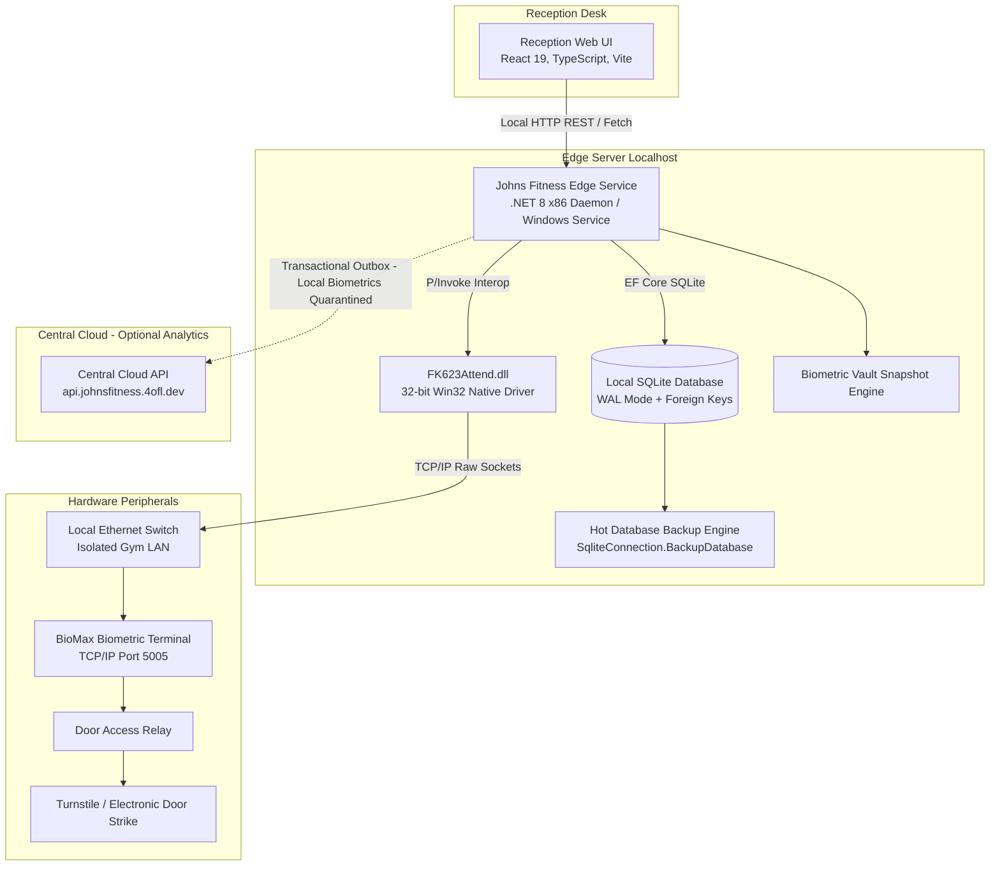

# Johns Fitness Edge — System Architecture

**Johns Fitness Edge** is an on-premise, offline-first gym management platform, double-entry financial ledger, and biometric IoT controller. It is engineered to operate 100% autonomously on local gym hardware without cloud dependency.

---

## 1. High-Level Topology



---

## 2. Architectural Pillars

### 2.1 Offline-First Autonomy (LAN First)
Fitness facilities cannot afford entrance bottlenecks during ISP outages or fiber cuts.
* All access evaluations, member lookups, POS billing, and relay unlock commands execute entirely on the local gigabit LAN.
* Door unlock execution latency is **< 15 milliseconds**.
* The gym remains 100% functional even if external internet is completely severed.

### 2.2 Native x86 Driver Bridge & Global Lock
Biometric hardware manufacturers frequently package unmanaged C dynamic libraries compiled exclusively for 32-bit (x86) architectures.
* Rather than running fragile inter-process communication proxies or COM wrappers, the edge daemon is compiled as a dedicated **32-bit .NET 8 runtime process** (`win-x86`).
* To prevent race conditions between background attendance polling workers and front-desk manual unlock requests, all hardware communication is governed by a thread-safe singleton lock: `BiomaxGlobalLock.Instance`.

### 2.3 SQLite Concurrency via WAL & Pragma Interceptor
The embedded database uses Entity Framework Core 8 backed by SQLite 3, configured via `SqliteConnectionPragmaInterceptor`:
```sql
PRAGMA journal_mode = WAL;
PRAGMA synchronous = NORMAL;
PRAGMA busy_timeout = 5000;
PRAGMA foreign_keys = ON;
```
* **Concurrent Readers**: Unlimited non-blocking reads across the reception dashboard, background polling workers, and audit reporters.
* **Isolated Writers**: Write transactions are serialized with a 5,000ms spin-lock timeout, eliminating `database is locked` exceptions under heavy desk activity.

### 2.4 Biometric Zero-Knowledge Cloud Isolation
To guarantee full compliance with data protection laws (such as the Digital Personal Data Protection Act and GDPR), the edge daemon enforces a strict **Zero-Knowledge Privacy Barrier**:
* The outbox dispatcher (`CloudSyncWorker`) filters every event before transmission.
* Any records referencing `BiometricCredential`, `BiometricDevice`, `BiometricEventJournal`, or raw biometric payloads are permanently quarantined on local premise storage and marked completed without network dispatch.
* Only anonymized business events (subscriptions, payments, invoices, attendance aggregates) sync upstream.

### 2.5 Resilient Transactional Outbox Pattern
State changes designated for cloud telemetry are written to a `SyncOutboxEvents` table within the exact same database transaction as the primary business entity.
* A background worker (`CloudSyncWorker`) polls pending events in batches of 50.
* Dispatches payloads to the cloud endpoint using dynamically generated JWT bearer tokens.
* Applies exponential backoff on network failures, guaranteeing eventual consistency without blocking desk operations.

### 2.6 Hot Online Database Backups & Integrity Verification
The system incorporates an automated backup engine (`BackupService.cs`):
* Utilizes `SqliteConnection.BackupDatabase` to stream live hot snapshots without terminating active database connections or locking readers.
* Performs full `PRAGMA integrity_check` validation on every backup artifact before acknowledging success.
* Enforces pre-restore safety snapshots before any manual or automated database restoration can proceed.

---

## 3. Subsystem Domain Architecture

```
JohnsFitness
├── apps/
│   ├── edge-service/         # .NET 8 x86 ASP.NET Core Daemon
│   ├── reception-web/        # React 19 + TypeScript Front Desk UI
│   ├── cloud-api/            # Central Cloud API & Multi-branch Aggregator
│   └── whatsapp-worker/      # Scheduled Notification & Reporting Stubs
└── packages/
    ├── Biomax.Connector/     # Win32 P/Invoke Native Driver Bridge
    ├── JohnsFitness.Data/    # EF Core 8 SQLite Database & Migrations
    ├── contracts/            # Shared DTOs and Protocol Interfaces
    └── api-client/           # Strongly-typed HTTP Client SDK
```

### 3.1 Financial Ledger & Paise Precision
* Monetary attributes are stored as 64-bit integers in **paise** (`long TotalPaise`), preventing floating-point calculation drift.
* Follows a double-entry payment model: `Invoice` lines track receivables, `PaymentCollection` tracks receipts, and `PaymentAllocation` maps funds to line items.
* Tenders support atomic payment splits (e.g. 50% Cash + 50% UPI) within a single receipt transaction.

### 3.2 Access Grant & Gate Policy Engine
* Access permissions are evaluated dynamically based on membership status (`Active`), start/end validity dates, active freeze allowances (`MembershipFreeze`), and plan-specific door access rules (`Plan.GrantsDoorAccess`).
* The door relay triggers instantly via `FK_SetDoorStatus(machineNo, DOOR_COMMAND = 3)` with an automatic 5,000ms hardware auto-reset.

### 3.3 Lead Pipeline & CRM Architecture
* Ingests enquiries across 5 channels: Walk-in, Phone, Instagram, Referral, and Website.
* Operates a strict 5-stage state machine: `New` -> `Contacted` -> `TrialScheduled` -> `Converted` / `Lost`.
* Front desk alerts highlight overdue follow-ups, with a 1-click action to convert leads into full member profiles.

### 3.4 Staff Roster & Biometric Shift Management
* Manages staff profiles, assigned roles (`Admin`, `Receptionist`, `Trainer`), and daily attendance status.
* Correlates terminal biometric scans against staff roster shifts (`StaffAttendanceDay`) with support for receptionist manual overrides.

### 3.5 Messaging Pipeline & Automated WhatsApp Architecture
The gym notification engine operates across a dual-phase delivery strategy designed to balance zero initial API overhead with unattended automation:

* **Phase 1: Client-Side Deep Linking (Active Production)**: Front-desk receptionists generate official receipts and renewal reminders via dynamic `wa.me` Click-to-Chat protocol URLs with zero marginal cost and zero third-party gateway dependencies.
* **Phase 2: Headless Background Worker (`apps/whatsapp-worker`) (In Active Development)**: Active development is underway on a dedicated background worker daemon. Once deployed, it will consume events from `SyncOutboxEvents` and local cron schedules to autonomously dispatch:
  * **Instant Payment Receipts**: Dispatched directly to the customer's phone upon POS invoice settlement without requiring manual front-desk clicks.
  * **Automated Expiry Alerts**: Pre-scheduled expiry countdown sequences (T-7, T-3, T-1 days) sent to expiring members automatically.
  * **Member Churn Re-engagement**: Automated greeting and reactivation messages triggered after 10+ consecutive days of turnstile inactivity.

---

## 4. Security & Role-Based Access Control

* **Authentication**: Password hashes secured with `BCrypt.Net-Next`. Session authentication powered by signed JWT bearer tokens.
* **Role Hierarchy**:
  * `Admin`: Full access including financial reports, staff payroll, system settings, database backups, and biometric vault restoration.
  * `Receptionist`: Member lookups, POS billing, receipt generation, enquiries, renewals, and manual door unlock.
  * `System`: Reserved identity for background workers, IoT daemons, and sync outbox dispatchers.
