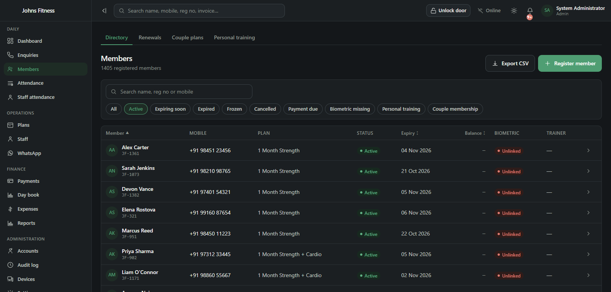
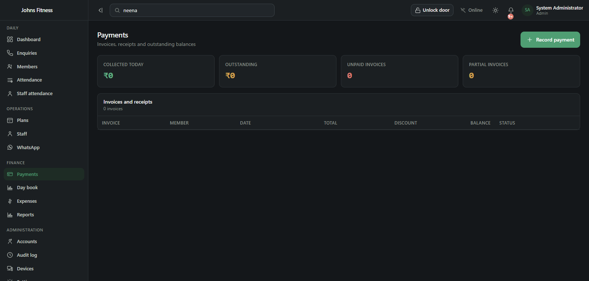
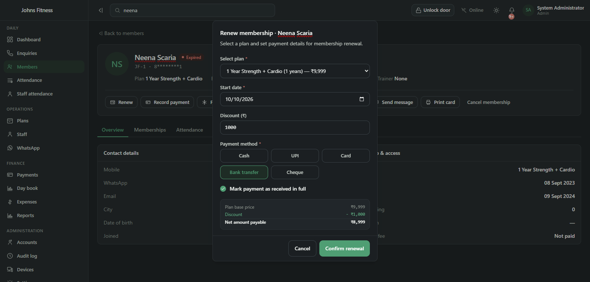
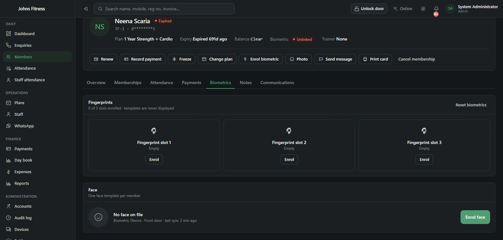
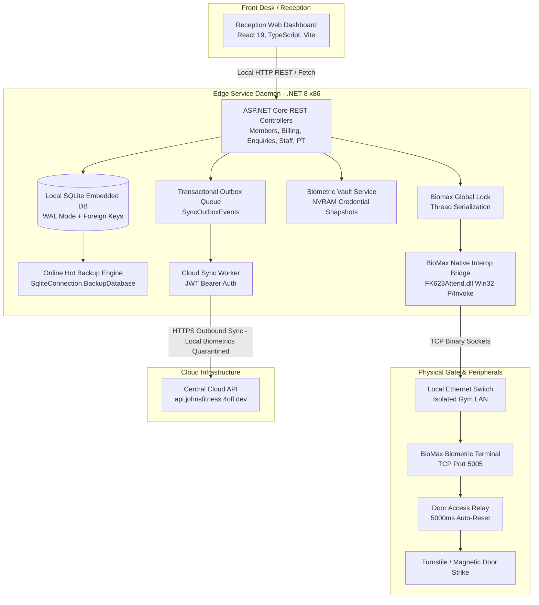

# Johns Fitness Edge

  <b>On-premise edge reception operating system, double-entry financial ledger, and biometric IoT hardware relay controller for Johns Fitness Gym.</b>

[Architecture](ARCHITECTURE.md) • [Hardware Protocol](docs/hardware-protocol.md) • [Financial Ledger](docs/ledger-and-accounting.md) • [CRM & Leads](docs/crm-enquiries.md) • [Privacy & Cloud Sync](docs/privacy-and-sync.md) • [Personal Training](docs/personal-training.md) • [Migration Pipeline](docs/migration-pipeline.md)

---

## Executive Summary

**Johns Fitness Edge** is an offline-first management platform, financial engine, and biometric access control daemon engineered specifically for **Johns Fitness Gym** (Kudungoor, Kottayam, Kerala).

It replaces a legacy 2013 desktop installation with a high-performance on-premise system that bridges physical turnstiles, optical fingerprint scanners, automated billing, and member lifecycles with **sub-millisecond local latency** and **zero internet dependency** for physical access.

---

## System Showcase

### 1. Members Directory (1,405 Registered Members)
*Live directory displaying registration numbers, active/expired statuses, latest plans, and biometric links.*

  

### 2. Payments & Shift Reconciliation (Clean Slate)
*Zero-drift Day Book tracking daily cash drawer collections, outstanding ledger dues, and partial invoices.*

  

### 3. One-Click Membership Renewal Flow
*Instant renewal supporting custom discounts, payment method splits, and automatic gate policy recalculation.*

  

### 4. Biometric Credential & Hardware Profile
*Real-time fingerprint linking, remote face capture sessions, and door strike override diagnostics.*

---

## System Architecture

---

## Engineering Highlights

### 1. 32-Bit Native Hardware Interop on Modern 64-Bit OS
* Biometric terminal vendor drivers (`FK623Attend.dll`) are restricted to unmanaged 32-bit binaries.
* The edge daemon runs as a tailored **.NET 8 x86 Windows Service** with unmanaged memory marshalling, eliminating fragile out-of-process IPC sockets.
* All hardware calls are protected by a singleton `BiomaxGlobalLock` to guarantee safe thread serialization across background polling workers and real-time reception commands.

### 2. Offline-First Autonomy (LAN First)
* Member lookups, check-in validation, and door access operate strictly across local gigabit ethernet.
* Complete immunity against internet outages, cloud downtime, or ISP fiber cuts. Physical gate unlocks in **< 15ms**.

### 3. Biometric Zero-Knowledge Cloud Isolation
* In compliance with modern biometric privacy regulations (DPDP Act / GDPR), the edge daemon enforces a strict **Zero-Knowledge Cloud Quarantine**.
* The background `CloudSyncWorker` automatically intercepts and discards any biometric credentials, raw templates, or biometric journal payloads from outbound synchronization.
* Raw biometric templates never leave the physical gym server; only anonymized business metrics sync upstream.

### 4. Biometric Vault & Fleet Disaster Recovery
* Biometric credentials stored in terminal NVRAM are backed up via `BiomaxBiometricVaultBackgroundService`.
* Complete fleet restoration (`POST /api/biomax/vault/restore-fleet`) enables 1-click redeployment of all 1,405 member credentials if the hardware is factory reset or replaced.

### 5. Double-Entry Financial Engine & Day Book
* All monetary calculations use 64-bit integer paise arithmetic, eliminating IEEE 754 floating-point rounding errors.
* Integrated Day Book balances daily cash drawer collections against operational expenses across mixed tenders (Cash, UPI, Card, NetBanking).

### 6. Legacy Jet Database Reverse Engineering & Clean Slate Cutover
* Decrypted and extracted 10+ years of legacy Access MDB records from GymSoft.
* Clean cutover preserved 1,405 active member profiles and latest plan expiries while resetting the accounting ledger to Invoice `#1` for clean tax and shift audits.

### 7. Dual-Phase WhatsApp Pipeline: Instant Deep Linking & Automated Background Dispatch
* **Production Implementation (Zero-Cost Deep Linking)**: Dynamic receipt and renewal reminder URLs generate instant `wa.me` Click-to-Chat deep links loaded with personalized Malayalam/English templates, eliminating upfront Meta Cloud API subscription overhead and third-party gateway dependencies.
* **Automated Pipeline (In Active Development)**: A dedicated background microservice (`apps/whatsapp-worker`) is in progress to fully automate outbound message delivery. Once cut over, the worker will asynchronously ingest outbox events to automatically dispatch digital GST receipts upon payment settlement, schedule T-7/T-3/T-1 membership expiration notices, and send churn re-engagement alerts without requiring manual front-desk clicks.

---

## Benchmarks & Performance

| Metric | Measured Value | Architecture Design |
| :--- | :--- | :--- |
| **Door Relay Response Time** | `< 15 ms` | Direct binary socket pool (no HTTP middleware) |
| **SQLite 1,405-Member Query** | `< 1.8 ms` | WAL mode + indexed composite primary keys |
| **Offline Resilience** | `100% Autonomous` | Zero external cloud API calls for check-in |
| **Memory Footprint** | `~65 MB` | Lightweight ASP.NET Core daemon (vs ~350MB Electron) |
| **Crash Recovery** | `< 2 seconds` | Supervised Windows Service auto-restart |
| **Hot Database Backup** | `< 120 ms` | Online `SqliteConnection.BackupDatabase` stream |

---

## Subsystem Overview

| Subsystem | Scope | Capabilities |
| :--- | :--- | :--- |
| **Access Control** | Biometric Hardware | 5s relay pulse, attendance log streaming, NVRAM recovery |
| **Biometric Vault** | Template Security | Automatic NVRAM snapshots, remote face/finger enrollment |
| **Billing & Invoices** | Financial Ledger | Integer paise precision, GST tax lines, receipt printing |
| **Day Book** | Shift Accounting | Cash drawer reconciliation, expense categories, tender splits |
| **CRM & Enquiries** | Sales Pipeline | Multi-channel lead tracking, follow-up alerts, 1-click conversion |
| **Personal Training** | Fitness Coaching | Trainer allocation, active session packages, renewal flows |
| **Staff Management** | Operations | Biometric shift tracking, role-based access, audit logging |
| **Cloud Outbox** | Sync Engine | Eventual consistency, privacy filters, exponential backoff |

---

## Technology Stack

| Layer | Technologies | Highlights |
| :--- | :--- | :--- |
| **Edge Server** | C# / .NET 8 (x86) | ASP.NET Core, Windows BackgroundService, P/Invoke |
| **Embedded DB** | SQLite 3 / EF Core 8 | WAL mode, synchronous=NORMAL, 5000ms busy timeout |
| **Frontend UI** | React 19, TypeScript, Vite | Custom CSS design system, dark mode, zero UI library bloat |
| **Biometric Hardware**| BioMax N-Series Terminal | TCP socket binary protocol (Port 5005), dry relay |
| **Driver Bridge** | FK623Attend Win32 DLL | 32-bit native library, unmanaged memory marshalling |
| **Security** | BCrypt, JWT Tokens | Strict role-based authorization (`Admin`, `Receptionist`, `System`) |
| **Messaging** | WhatsApp Deep Links (Current) + Background Worker (In Progress) | Client-side `wa.me` links + headless `whatsapp-worker` automation pipeline |

---

## Technical Documentation Index

* **[System Architecture](ARCHITECTURE.md)** — In-depth architectural blueprint, thread models, and concurrency.
* **[Hardware Protocol Specification](docs/hardware-protocol.md)** — Socket commands, P/Invoke signatures, and relay control.
* **[Financial Ledger & Day Book](docs/ledger-and-accounting.md)** — Integer paise calculations, invoice lifecycles, and cash drawer balancing.
* **[Lead Ingestion & CRM Pipeline](docs/crm-enquiries.md)** — Enquiry lifecycle, follow-up scheduling, and 1-click conversion.
* **[Personal Training Management](docs/personal-training.md)** — Trainer assignment, session quotas, and renewal lifecycles.
* **[Data Privacy & Cloud Sync](docs/privacy-and-sync.md)** — Biometric Zero-Knowledge isolation and transactional outbox.
* **[Legacy Migration Pipeline](docs/migration-pipeline.md)** — Jet 4.0 decryption, data cleaning, and clean cutover strategy.

---

## License
This repository is an architectural showcase and is published under the [MIT License](LICENSE).
