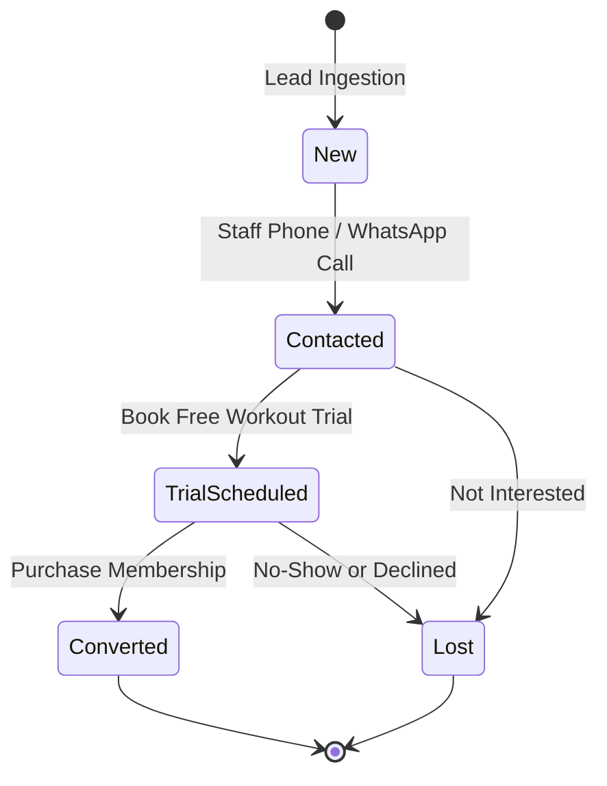

# Lead Ingestion & CRM Pipeline

This document details the enquiry management, prospective member tracking, and conversion pipeline implemented in **Johns Fitness Edge**.

---

## 1. Multi-Channel Lead Ingestion

Prospective gym members contact the facility through diverse channels. The enquiries engine normalizes incoming leads into a structured intake pipeline:

| Acquisition Source | Description | Typical Conversion Path |
| :--- | :--- | :--- |
| **Walk-in** | Direct front-desk walk-in visitor | Immediate facility tour + Free trial |
| **Instagram / Social** | Direct messages or Instagram ad inquiries | Phone follow-up + Scheduled trial |
| **Referral** | Referred by existing active gym member | High-intent, immediate plan purchase |
| **Phone Call** | Phone inquiry regarding pricing and hours | WhatsApp plan brochure + Follow-up |
| **Website** | Inquiries from the web portal | Automated lead intake queue |

---

## 2. Lead State Machine

Every lead progresses through a strict 5-stage lifecycle state machine:

### State Definitions
* **`New`**: Fresh lead received; awaiting first contact from reception.
* **`Contacted`**: Front-desk staff reached out via phone or WhatsApp; fitness goals and pricing discussed.
* **`TrialScheduled`**: Free 1-day gym trial booked for a specific date.
* **`Converted`**: Lead purchased a membership plan; converted into an active member.
* **`Lost`**: Lead declined or did not respond after follow-up period.

---

## 3. Scheduled Follow-Ups & Front-Desk Reminders

To ensure zero prospective members slip through the cracks:
* Every enquiry record supports an optional `FollowUpDate`.
* The dashboard API (`GET /api/enquiries?dueFollowUp=true`) extracts leads whose follow-up date matches today or is overdue.
* The reception UI highlights follow-up badges prominently on the navigation shell, prompting staff to execute timely reminder calls.

---

## 4. One-Click Member Conversion & Auto-Provisioning

When an enquiry decides to join:
1. Receptionist clicks **"Convert to Member"** on the enquiry record.
2. The system pre-fills the registration workflow with the lead's personal data (Full Name, Mobile Number, Email, Gender, Fitness Goals).
3. Atomically updates the enquiry status to `EnquiryStatus.Converted` and sets `ConvertedMemberId`.
4. Automatically assigns the next sequential registration number (`JF-XXXX`) and transitions into the plan selection and payment flow.
