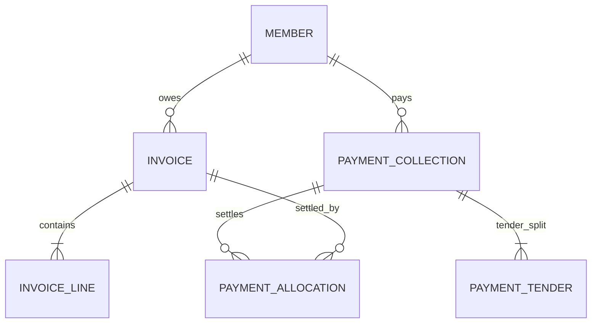

# Financial Ledger, Invoicing & Day Book

This document specifies the financial architecture, double-entry bookkeeping model, and cash drawer reconciliation engine powering **Johns Fitness Edge**.

---

## 1. Zero-Drift Currency Architecture (Integer Paise)

In high-volume gym billing, standard IEEE 754 floating-point numbers (`float` or `double`) inevitably cause fractional currency drift:
```
0.10 + 0.20 = 0.30000000000000004  // Unacceptable for tax accounting
```

### The Solution: 64-Bit Integer Arithmetic
All monetary fields across the database and API contracts are denominated strictly as **integer paise** (where 100 paise = 1 INR):
* Subtotal: `long SubtotalPaise`
* Discount: `long DiscountPaise`
* Tax: `long TaxPaise`
* Final Total: `long TotalPaise`

Floating-point representations are strictly restricted to final display rendering layers.

---

## 2. Invoicing & Double-Entry Allocation Model

The financial ledger separates invoices (receivables) from collections (actual receipts) via a relational allocation graph:



### 2.1 Invoices & Invoice Lines
* Every membership purchase, renewal, or personal training package creates an immutable `Invoice` with sequential numbering (`JF-INV-2026-0001`).
* Individual items (Plan Fee, Admission Fee, Personal Training) are stored as itemized `InvoiceLine` records with specific quantity, unit price, and tax amounts.

### 2.2 Payment Collections & Multi-Tender Splits
When a customer settles a bill, the desk creates a `PaymentCollection` with an official receipt number (`REC-0001`).
* Real-world transactions frequently involve split payments (e.g. ₹1,000 in Cash + ₹1,500 via UPI).
* The ledger represents this via multiple `PaymentTender` child entities linked to the single collection:
  ```json
  "tenders": [
    { "method": "Cash", "tenderAmountPaise": 100000 },
    { "method": "Upi",  "tenderAmountPaise": 150000 }
  ]
  ```

### 2.3 Payment Allocations
A single collection can allocate funds across multiple outstanding invoices (or future credit balances) via `PaymentAllocation` records, maintaining strict audit trails for partial payments.

---

## 3. Day Book & Cash Drawer Shift Balancing

Front-desk staff must balance their physical cash drawer at the end of each work shift. The **Day Book** (`GET /api/day-book`) provides an instantaneous real-time reconciliation ledger:

$$\text{Net Cash in Drawer} = \sum \text{Cash Inflows (Collections)} - \sum \text{Cash Outflows (Expenses)}$$

### Expense Tracking Engine
Operational gym expenses (electricity bills, equipment maintenance, water supply, cleaning materials) are recorded directly into the ledger:
* Categories: `Utilities`, `Maintenance`, `Equipment`, `Supplements`, `Salary`, `Miscellaneous`
* Recorded by staff user ID with timestamp and receipt reference.
* Deducted automatically from the Day Book cash balance for zero-discrepancy shift handovers.

---

## 4. Official GST Invoices & WhatsApp Delivery

The billing module renders official GST-compliant tax invoices containing:
* Gym Legal Entity, Address, and State Code (Kerala - 32)
* Sequential Invoice Number and Tax Date
* Member Name, Registration Code, and Phone Number
* Itemized Tax Breakdowns (CGST 9% + SGST 9%)
* Thermal Print Formatting (80mm standard receipt printer layout)

### WhatsApp Receipt Delivery & Automated Dispatch Pipeline
* **Current Front-Desk Flow (Zero Marginal Cost)**: Rather than incurring recurring Meta Cloud API fees for outbound receipts, the system generates client-side `wa.me` deep links. Dynamically formats receipt summaries with invoice numbers, amounts paid, and validity dates, allowing receptionists to deliver official receipts with a single click.
* **Automated Background Dispatch (In Active Development)**: The billing workflow is being enhanced with automated background delivery via `apps/whatsapp-worker`. Upon invoice settlement, the edge daemon will enqueue an outbox event to dispatch official PDF/Text receipts directly to the member's WhatsApp without requiring manual staff interaction.
